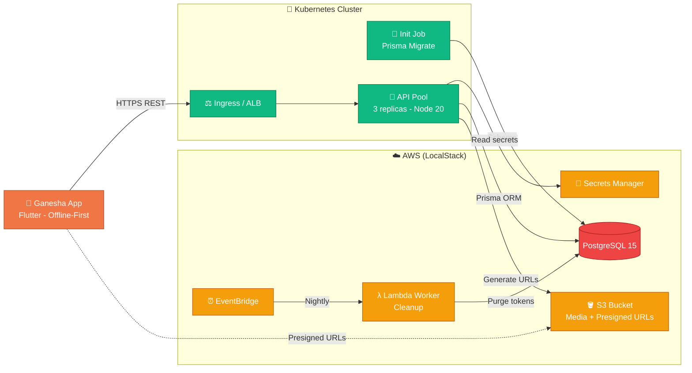

# Cahier des charges AWS ProServe

> **Confidentiality & IP Notice:** This repository contains the Cloud Modernization Blueprint, Infrastructure as Code (Terraform), Kubernetes manifests, and Architecture Decision Records (ADRs) for the **Ganesha (Ganesh'up)** production learning platform (published on the App Store by Lebourgmestre sàrl). To protect proprietary business logic, the full application source code remains in a private repository; a lightweight behavioral clone (`mock-api/`) exposing the exact production routes (`/api/health`, `/api/courses/share`, `/api/courses/cleanup`) is provided to validate the infrastructure locally via **LocalStack** and **k3d**.

---

## 1. Executive Summary & Engagement Context

**Ganesh'up** is an offline-first Flutter learning application backed by a **Node.js 20 / Typescript** REST API, **Prisma ORM**, **PostgreSQL 15**

Initially engineered for rapid time-to-market, the v1.0 production backend ran as a single-node `docker-compose` stack deployed via an atomic one-minute Bash script (`pg_dump` 3-2-1 backup, SHA-tagged build, container restart, and `/api/health` check). While effective for early adoption, an architectural audit conducted against the **AWS Well-Architected Framework** identified four structural bottlenecks preventing horizontal scale and zero-downtime operations.

---

## 2. Architectural Audit: "As-Is" Bottlenecks vs. "To-Be" AWS Target

> **Bottleneck identified by Stateful, CPU-RAM-Bandwidth, BDD-Lifecycle, Administrative Process**

| Bottleneck Identified ("As-Is") | Operational & Business Risk | AWS Modernization Solution ("To-Be") |
| :--- | :--- | :--- |
| **1. Stateful Local Disk Storage** Course media (images/ & audio/) written to container a container env path (./uploads) | **Blocks Horizontal Scaling:** Running more than 1 API replica will causes 404 Not Found on GET /api/.../:token when requests hit a different container. | **Stateless Compute + Amazon S3** Offload media storage to **Amazon S3** with **S3 Lifecycle Policies** for automatic expiration of old files. |
| **2. Heavy 50MB Base64 Payloads** POST /api/.../share ingests and decode up to 50MB of Base64 JSON in-memory. | **Event-Loop Starvation & Out of Memory:** Base64 decoding spikes Node.js memory and block concurrent /api/auth requests. | **S3 Predesigned URLs & Async Workers:** Decouple binary uploads from JSON metadata (shared_courses table) and process media asynchronously via **SQS + Lambda.** |
| **3. Single-Node Deployment & Prisma Migrations**  Atomic restart script + manual npx prisma migrate deploy. | **Deployment Downtime:** Brief connection drops during container restarts interrupt active mobile sync queues. | **Kubernetes (k3d/EKS) RollingUpdate:** 3 stateless replicas (maxUnavailable: 0) gated by /api/health on port 3000 + K8s InitContainer for Prisma migrations. |
| **4. External Cron Calling HTTP endpoint** Periodic cron hitting GET /api/.../cleanup + plaintext secrets. | **Security & Reliability Risk:** Admin maintenance logic exposed on API router; credentials stored on host disk. | **EventBridge Scheduler + AWS Secrets Manager:** Serverless sheduled cleanup task and centralized secrets injection via **Terraform.** |
| **5. Zombie Redis & In-Memory Rate-Limiting** Idle redis:7-alpine container running unused while express-rate-limit uses local Node.js RAM. | **Cloud Waste & Security Bypass:** Lift-and-shift would bill for an unused ElastiCache cluster; local RAM rate-limiting (5 req/15min) is multiplied by the number of API replicas. | **Resource Decommissioning (FinOps) & Edge Rate-Limiting:** Decommission Redis completely and enforce global rate-limiting at the **Kubernetes Ingress / ALB WAF** layer. |
| **6. In-Place Production Builds & Manual TLS/Nginx** deploy.sh compiles Docker on the production VPS (37GB cache bloat), runs --force-recreate nginx, and manages Let's Encrypt via sudo hooks. | **CPU Theft, Disk Saturation & TLS Drops:** Building images on the host steals CPU from live traffic and risks disk exhaustion; recreating Nginx drops active TLS connections. | **CI-Built Immutable Images + Managed Edge:** Build SHA-tagged images in **GitHub Actions** (pushed to ECR) and offload TLS termination/renewal to **AWS ACM + Ingress**. |

### 2.1 Empirical Baseline: "As-Is" Load Test & Telemetry

To quantify the operational impact of **Bottlenecks**, we benchmark via a load test mock-api/benchmark.as-is.sh

| Test Scenario (~15 MB Base64 Payload) | Concurrency | Total Latency | Idle RAM (RSS) | Peak RAM (RSS) | RAM Multiplier | Peak CPU (1 Core) |
| :--- | :--- | :--- | :--- | :--- | :--- | :--- |
| **Single User Baseline** | 1 request | **113 ms** | ~17.5 MB | **~260 MB** | **15x** | 59.0% |
| **Concurrent Burst** | 10 requests | **704 ms** | ~8.0 MB | **~735 MB** | **91x** | 59.8% |

**Key Telemetry Findings:**
* Immediate **OOMKilled** Risk (Bottleneck #2): 10 concurrent uploads spike Node.js Resident Set Size (RSS) from **8 MB to 735 MB** as V8 allocates entire JSON strings and decoded binary buffers in memory simultaneously. On standard 512 MB / 1 GB container limits, this triggers a Linux Kernel Out-Of-Memory kill
* **Event Loop Starvation:** Because JSON.parse(), Buffer.from(), and fs.writeFileSync() execute synchronously on the single Node.js main thread requests are serialized. Total process time degrades by **>6x** (113 ms to 704 ms), blocking lightweight endpoints (/api/health, /api/auth) during file ingestion
* **Stateful Disk Pollution** (Bottleneck #1): A single 10-request burst wrote **150 binary files** directly to the local container path, which confirm that local filesystem persistence prevents horizontal scaling across multiple Kubernetes pods

### 2.2 Post-Modernization Validation: "To-Be" Load Test & Telemetry

To validate each **AWS Modernization Solution**, we replay the identical workload (15 media items per request) against the stateless stack via mock-api/benchmark.to-be.sh

| Test Scenario (~0.6 KB Metadata Payload) | Concurrency | Total Latency | Idle RAM (RSS) | Peak RAM (RSS) | RSS Growth | Peak CPU (1 Core) |
| :--- | :--- | :--- | :--- | :--- | :--- | :--- |
| **Single User Baseline** | 1 request | **31 ms** | ~295 MB | **~295 MB** | **+0 MB** | 5.1% |
| **Concurrent Burst** | 10 requests | **85 ms** | ~350 MB | **~362 MB** | **+12 MB** | 62.2% |

**Key Telemetry Findings:**
* **OOMKilled Risk Eliminated** (Bottleneck #2): the 10-request burst peaks at **362 MB instead of 735 MB**, and more decisively grows by only **+12 MB** above its own idle baseline. The API ingests 0.6 KB of JSON metadata and returns 15 S3 Presigned URLs, so V8 never allocates entire JSON strings nor decoded binary buffers, and the 512 MB container limit stops being a function of concurrency
* **Event Loop Preserved:** Total process time drops from **704 ms to 85 ms** on the same burst, because JSON.parse() now handles a 0.6 KB string and getSignedUrl() is a pure in-memory HMAC-SHA256 signature with no synchronous fs.writeFileSync() on the main thread. Lightweight endpoints (/api/health, /api/auth) stay responsive during ingestion
* **Stateless Compute Confirmed** (Bottleneck #1): the same 10-request burst wrote **0 binary files** to the local container path against 150 previously, which unblocks the 3-replica RollingUpdate since no pod retains media that a sibling pod cannot serve
* **Resident Baseline Trade-Off:** the three AWS SDK clients raise the idle footprint from ~258 MB to ~350 MB, a constant **+92 MB per replica**. This is a sizing cost and not a scaling one, as it does not grow with traffic where the As-Is cost did
* **Peak CPU Trade-Off** (Bottleneck #5): signing 150 Presigned URLs holds peak CPU at **62.2%**, marginally above the As-Is 59.8%. The burst is 8x shorter so cumulative CPU time collapses, but a single core still saturates, which confirms that Edge Rate-Limiting at the Kubernetes Ingress remains required and cannot be relegated to in-process Node.js RAM

---

## 3. Target Architecture ("To-Be" C4 Container View)

